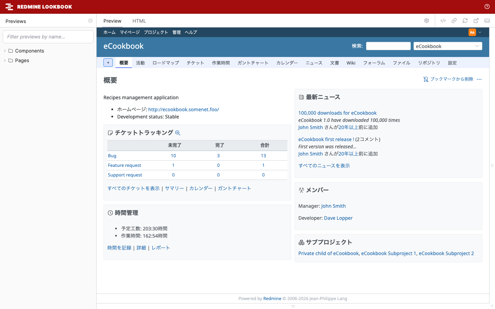

# Redmine Lookbook

[](https://github.com/redmine-kit/redmine_lookbook/actions/workflows/ci.yml)
[](LICENSE)

Redmine Lookbook は、Redmine のコンポーネントと画面を [Lookbook](https://lookbook.build/) でプレビューする Redmine 7 のプラグインです。テーマの作者は、Redmine の画面を一つずつ開かなくても、多くの画面、言語、レイアウトでテーマを確認できます。

[English](README.md)



> **状態:** 開発の初期段階です(0.1.0)。Redmine 7.0 に対応し、Redmine 7.0.3 で動作を確認しています。

## ドキュメント

- Web サイト: https://redmine-kit.github.io/redmine_lookbook/ja/ (English: https://redmine-kit.github.io/redmine_lookbook/)
- Markdown: [docs/ja/README.md](docs/ja/README.md) (English: [docs/README.md](docs/README.md)) と、そこからリンクしているページ

ドキュメントには、[インストール](docs/ja/installation.md)、[ツールバー](docs/ja/usage.md)、[すべてのプレビュー](docs/ja/previews.md)、[テーマの作者のためのチェックリスト](docs/ja/theme-checklist.md)、[Redmine 7 がテーマを適用する仕組み](docs/ja/themes.md)、[独自のプレビューの書き方](docs/ja/writing-previews.md)があります。

## 機能

- **Redmine がレンダリングする:** コンポーネントは Redmine のヘルパーと部分テンプレートで、画面は Redmine のコントローラーでレンダリングします。
- **265 のプレビュー:** コンポーネントが 56、画面が 209 で、ヘッダー、メニュー(開いた状態)、チケットの一覧から、リポジトリのブラウザー、管理のすべての画面まであります。
- **ツールバーでの切り替え:** テーマ、言語、レイアウトを切り替えられます。既定は Redmine の設定に合わせます。
- **テストデータ:** Redmine 自身のテストデータとテスト用のリポジトリ(Subversion、Git、Mercurial)で画面を表示します。

## クイックスタート

```sh
git clone https://github.com/redmine-kit/redmine_lookbook.git
cd redmine_lookbook
docker compose -f docker/compose.yml up --build
```

起動したら <http://127.0.0.1:3000/lookbook> を開きます。既存の Redmine へのインストールは、[インストール](docs/ja/installation.md#an-existing-redmine)を参照してください。

## 動作環境

- Redmine 7.0
- Redmine 7.0 が対応する Ruby
- [Lookbook](https://github.com/lookbook-hq/lookbook) 2.3

## セキュリティ

Redmine Lookbook は開発用のツールです。本番のサーバーでは決して有効にしないでください。`/lookbook` を開ける人は、管理者としてレンダリングした画面を見られます。Redmine のテストデータだけがある Redmine で使ってください。[セキュリティ](docs/ja/security.md)を参照してください。脆弱性の報告の方法は [SECURITY.md](SECURITY.md) にあります。

<a id="sponsors"></a>

## スポンサー

<a href="https://localstack.cloud">
  <picture>
    <source media="(prefers-color-scheme: dark)" srcset=".github/assets/localstack-logo-dark.svg">
    
  </picture>
</a>

<a id="license"></a>

## ライセンス

Redmine Lookbook は、GNU General Public License バージョン 2 またはそれ以降のバージョンで公開しています。[LICENSE](LICENSE) を参照してください。Redmine projectとは関係ありません。

- Redmine は Jean-Philippe Lang の著作物で、GPL で公開されています。
- Lookbook は MIT License で公開されています。
