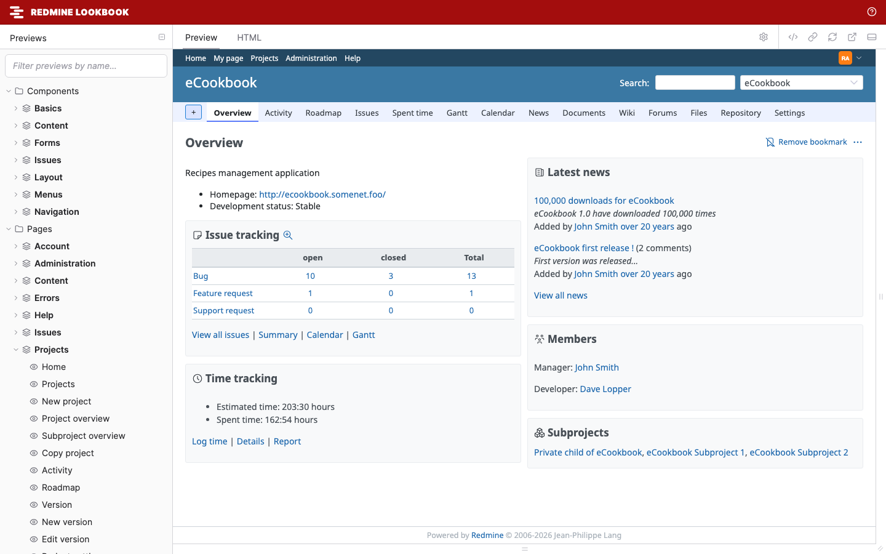

# Redmine Lookbook

[](https://github.com/redmine-kit/redmine_lookbook/actions/workflows/ci.yml)
[](LICENSE)

Redmine Lookbook is a Redmine 7 plugin that previews Redmine's components and pages in [Lookbook](https://lookbook.build/). Theme authors can check a theme across many screens, languages and layouts without clicking through Redmine.

[日本語](README.ja.md)



> **Status:** early development (0.1.0). It supports Redmine 7.0 and has been checked with Redmine 7.0.3.

## Documentation

- Website: https://redmine-kit.github.io/redmine_lookbook/ (日本語: https://redmine-kit.github.io/redmine_lookbook/ja/)
- Markdown: [docs/README.md](docs/README.md) (日本語: [docs/ja/README.md](docs/ja/README.md)) and the pages it links

The documentation covers [installation](docs/installation.md), [the toolbar](docs/usage.md), [every preview](docs/previews.md), and [writing your own previews](docs/writing-previews.md). How Redmine 7 applies themes and a checklist for theme authors are in the [Redmine Design Guide](https://redmine-kit.github.io/design-guide/) ([themes](https://redmine-kit.github.io/design-guide/themes.html), [theme checklist](https://redmine-kit.github.io/design-guide/theme-checklist.html)).

## Features

- **Rendered by Redmine:** components with Redmine's own helpers and partials, and pages with Redmine's own controllers.
- **265 previews:** 56 components and 209 pages, from the header, the menus (shown open) and the issue list to the repository browser and every administration page.
- **Toolbar options:** switch the theme, the language and the layout. The defaults follow Redmine's own settings.
- **Test data:** Redmine's own test data and test repositories (Subversion, Git and Mercurial) fill the screens.

## Quick start

```sh
git clone https://github.com/redmine-kit/redmine_lookbook.git
cd redmine_lookbook
docker compose -f docker/compose.yml up --build
```

Then open <http://127.0.0.1:3000/lookbook>. To install into an existing Redmine, see [Installation](docs/installation.md#an-existing-redmine).

## Requirements

- Redmine 7.0
- A Ruby version that Redmine 7.0 supports
- [Lookbook](https://github.com/lookbook-hq/lookbook) 2.3

## Security

Redmine Lookbook is a development tool. Never enable it on a production server: anyone who can open `/lookbook` sees pages rendered as an administrator. Use it only in a Redmine with Redmine's test data. See [Security](docs/security.md), and [SECURITY.md](SECURITY.md) to report a vulnerability.

## License

Redmine Lookbook is released under the GNU General Public License, version 2 or (at your option) any later version. See [LICENSE](LICENSE). An unofficial Redmine plugin.

- Redmine is © Jean-Philippe Lang and released under the GPL.
- Lookbook is released under the MIT License.
