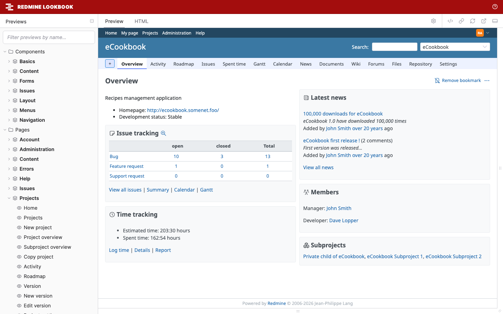

# Redmine Lookbook

Redmine Lookbook is a Redmine 7 plugin that previews Redmine's components and pages in [Lookbook](https://lookbook.build/). Theme authors can check a theme across many screens, languages and layouts without clicking through Redmine.



- [Installation](installation.md): the Docker setup, or an existing Redmine, and Redmine's test data
- [Using the previews](usage.md): the toolbar, checking a theme, narrow screens and printing
- [Preview list](previews.md): every component and page preview, with the Redmine page it renders
- [Writing previews](writing-previews.md): previews for your own theme or plugin
- [Configuration](configuration.md): environment variables
- [How it works](how-it-works.md): how components and pages are rendered
- [Security](security.md): where to run it, and what it shows

How Redmine 7 applies a theme, and a checklist of what a theme has to handle with the preview for each item, are in the [Redmine Design Guide](https://redmine-kit.github.io/design-guide/) ([themes](https://redmine-kit.github.io/design-guide/themes.html), [theme checklist](https://redmine-kit.github.io/design-guide/theme-checklist.html)).

Redmine Lookbook is in early development (0.1.0). It supports Redmine 7.0 only and has been checked with Redmine 7.0.3 and Lookbook 2.3.15.

## Features

- **Rendered by Redmine:** components are rendered with Redmine's own helpers and partials, and pages by Redmine's own controllers. No HTML is copied by hand, so the previews follow Redmine's markup.
- **Many screens:** 265 previews: 56 components and 209 pages. The components include Redmine's layout parts (the header, the top menu, the flyout menu, the sidebar and the footer) and menus shown open (the context menu, "Jump to a project", the "+" menu, the actions menu and the account menu). The pages range from the issue list and the Gantt chart to the repository browser and every administration page. See the [preview list](previews.md).
- **Toolbar options:** switch the theme, the language and the layout while you look at a preview. The defaults follow Redmine's own settings.
- **Wiki formatting:** sample texts in CommonMark and Textile cover Redmine's formatting, links to Redmine objects and macros.
- **Test data:** Redmine's own test data (`test/fixtures`) fills the screens with projects, issues, wiki pages and more, and the test repositories of Redmine's tests (Subversion, Git and Mercurial) fill the repository pages.
- **Your own previews:** add previews for your theme or plugin from another directory.

## Quick start

```sh
git clone https://github.com/redmine-kit/redmine_lookbook.git
cd redmine_lookbook
docker compose -f docker/compose.yml up --build
```

Then open <http://127.0.0.1:3000/lookbook>. See [Installation](installation.md) for the details.

## License

Redmine Lookbook is released under the GNU General Public License, version 2 or (at your option) any later version. See [LICENSE](../LICENSE). An unofficial Redmine plugin.
