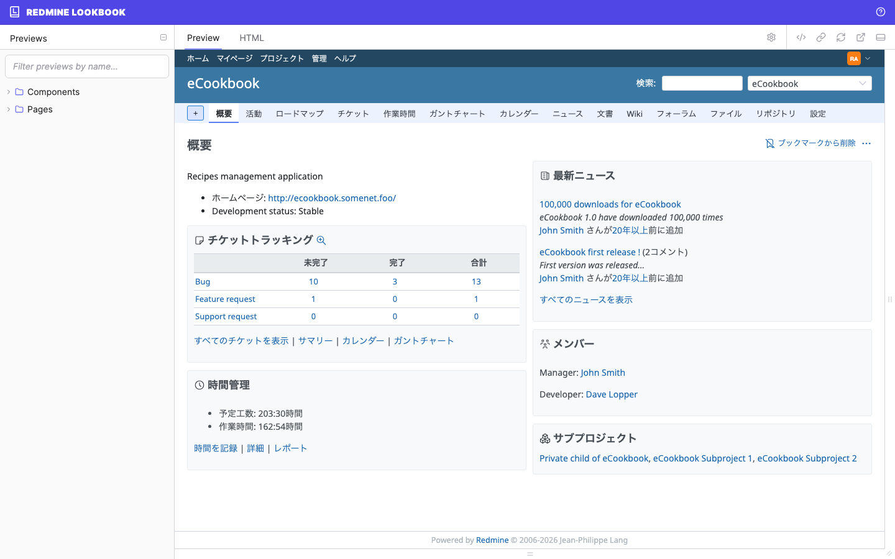

# Redmine Lookbook

Redmine Lookbook は、Redmine のコンポーネントと画面を [Lookbook](https://lookbook.build/) でプレビューする Redmine 7 のプラグインです。テーマの作者は、Redmine の画面を一つずつ開かなくても、多くの画面、言語、レイアウトでテーマを確認できます。



- [インストール](installation.md): Docker での環境、または既存の Redmine へのインストールと、Redmine のテストデータ
- [プレビューの使い方](usage.md): ツールバー、テーマの確認、狭い画面と印刷
- [プレビューの一覧](previews.md): すべてのコンポーネントと画面のプレビューと、それぞれがレンダリングする Redmine の画面
- [テーマのチェックリスト](theme-checklist.md): Redmine 7 のテーマが対応する必要のある項目、項目ごとのプレビュー、プレビューで確認できない項目
- [Redmine 7 のテーマ](themes.md): Redmine 7 がテーマを見つけ、読み込み、適用する仕組み
- [プレビューを書く](writing-previews.md): 自作のテーマやプラグインのプレビュー
- [設定](configuration.md): 環境変数
- [仕組み](how-it-works.md): コンポーネントと画面をレンダリングする仕組み
- [セキュリティ](security.md): 動かす場所と、表示される内容

Redmine Lookbook は開発の初期段階です(0.1.0)。対応するのは Redmine 7.0 だけで、Redmine 7.0.3 と Lookbook 2.3.15 で動作を確認しています。

<a id="features"></a>

## 機能

- **Redmine がレンダリングする:** コンポーネントは Redmine のヘルパーと部分テンプレートで、画面は Redmine のコントローラーでレンダリングします。手で写した HTML は使わないので、プレビューは Redmine のマークアップのとおりです。
- **多くの画面:** 265 のプレビューがあります。コンポーネントが 56、画面が 209 です。コンポーネントには、Redmine のレイアウトの部品(ヘッダー、トップメニュー、フライアウトメニュー、サイドバー、フッター)と、開いた状態のメニュー(コンテキストメニュー、「プロジェクトへ移動」、操作のメニュー、アカウントのメニュー)があります。画面は、チケットの一覧やガントチャートから、リポジトリのブラウザー、管理のすべての画面まであります。[プレビューの一覧](previews.md)を参照してください。
- **ツールバーでの切り替え:** プレビューを見ながら、テーマ、言語、レイアウトを切り替えられます。既定は Redmine の設定に合わせます。
- **wiki の書式:** CommonMark と Textile のテスト用の文章で、Redmine の書式、Redmine のオブジェクトへのリンク、マクロを確認できます。
- **テストデータ:** Redmine 自身のテストデータ(`test/fixtures`)で、プロジェクト、チケット、wiki のページなどを表示し、Redmine のテストのリポジトリ(Subversion、Git、Mercurial)でリポジトリの画面を表示します。
- **独自のプレビュー:** テーマやプラグインのプレビューを、別のディレクトリから追加できます。

<a id="quick-start"></a>

## クイックスタート

```sh
git clone https://github.com/redmine-theme/redmine_lookbook.git
cd redmine_lookbook
docker compose -f docker/compose.yml up --build
```

起動したら <http://127.0.0.1:3000/lookbook> を開きます。詳しくは[インストール](installation.md)を参照してください。

<a id="license"></a>

## ライセンス

Redmine Lookbook は、GNU General Public License バージョン 2 またはそれ以降のバージョンで公開しています。[LICENSE](../../LICENSE) を参照してください。
