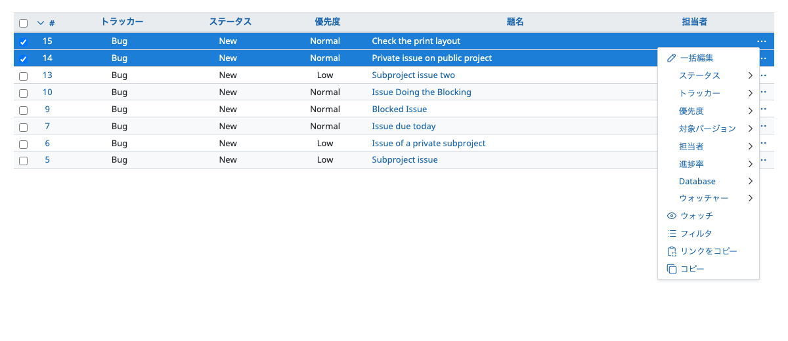
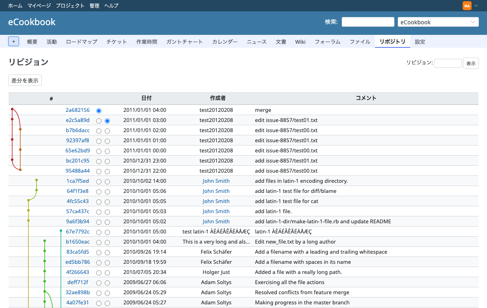

# テーマのチェックリスト

Redmine 7 のテーマが対応する必要のある項目と、それぞれを確認するプレビューです。プレビューは、Lookbook のナビゲーションに表示される名前で書いています([プレビューの一覧](previews.md))。Redmine がテーマを適用する仕組みは、[Redmine 7 のテーマ](themes.md)を参照してください。

各項目は、まずツールバーの既定で確認し、次の設定でも確認します。

- 「Redmine layout」: ヘッダー、メニュー、サイドバー
- 右から左に書く言語(アラビア語、ペルシア語、ヘブライ語)
- 長い単語の言語(たとえばドイツ語)と、ほかの文字の言語(たとえば日本語)
- 狭いプレビュー欄(幅 900 ピクセル未満): `responsive.css`

## 準備

| 項目 | 確認すること | プレビュー |
| --- | --- | --- |
| Redmine のスタイル | `application.css` が Redmine の `application.css` を読み込むか、すべてを置き換えている | どれでも |
| 色とフォント | カスタムプロパティ(`--color-header-background`、`--fonts-main`、Open Color の `--oc-*`)で、意図した色になる | Pages » Projects » Project overview |
| 置き換えたスタイルシート | テーマの `gantt.css`、`context_menu.css`、`jstoolbar.css`、`scm.css`、`dropdown.css`、`responsive.css`(あれば)が、Redmine のファイルの内容を満たしている | Gantt chart、Context menu、Text area with the wiki toolbar、Diff |
| ファビコンと `theme.js` | ファビコンが表示され、`theme.js` がブラウザーのコンソールにエラーを出さない | 「Redmine layout」のどの画面でも |

## レイアウト

| 項目 | 確認すること | プレビュー |
| --- | --- | --- |
| レイアウトの全体 | すべての部品を合わせた形: プロジェクトのある画面とない画面、ログインしていない状態、終了したプロジェクト | Layout » Whole layout、Whole layout without a project、Whole layout, signed out、Whole layout of a closed project |
| トップメニューとアカウントのメニュー | リンク、アバター、開いたアカウントのメニュー、ログインしている状態としていない状態 | Layout » Top menu、Top menu with the account menu open、Top menu, signed out |
| ヘッダー | タイトル、検索、閉じた状態と開いた状態の「プロジェクトへ移動」 | Layout » Header with the project menu、Menus » Jump to a project, open |
| プロジェクトのメニュー | タブ、選択中のタブ、多くのモジュール、「+」のメニュー | Project menu、Menus » New object menu ("+") in the project menu, open |
| サイドバー | 幅、リンク、選択中のリンク、サイドバーのフォーム、隠した状態 | Layout » Sidebar、Whole layout with the sidebar hidden、Issue sidebar |
| 本文 | タイトルとパンくずリスト、`.contextual` のリンク、splitcontent | Title with breadcrumbs、Pages » Projects » Project overview |
| サイドバーのない画面 | `#main.nosidebar` | Pages » Issues » New issue |
| フッター | | Layout » Footer |
| 狭い画面 | ヘッダーのバー、フライアウトメニュー、スクロールするテーブル | 狭いプレビュー欄の Layout » Whole layout with the flyout menu open、「Redmine layout」のどの画面でも |
| 印刷 | メニューと操作の部分が印刷されない | どの画面でも、ブラウザーの印刷プレビューで |

## ナビゲーション

「Menus」のプレビューは、メニューを開いた状態で表示します。たとえば、チケットの一覧のコンテキストメニューです。

| 項目 | 確認すること | プレビュー |
| --- | --- | --- |
| タブ | 選択中のタブ、多くのタブ(スクロールのボタン) | Tabs、Menus » Tabs with scroll buttons、Pages » Settings |
| メニュー | 開いたドロップダウン: 操作、コンテキストメニュー、アカウント | Menus |
| 管理のメニュー | アイコンと選択中の項目 | Administration menu、Pages » Administration » Administration |
| ページ送り | 現在のページ、1 ページの件数 | Pagination |

## 基本の要素

| 項目 | 確認すること | プレビュー |
| --- | --- | --- |
| 文字 | wiki の外の見出し、段落、リンク、リスト、コード | Headings and text |
| フラッシュメッセージ | 通知、警告、エラー | Flash messages |
| 警告と空の一覧 | 警告、競合、空の一覧 | Notices and empty states |
| ボタンとリンク | ボタン、アイコンのリンク、無効の状態 | Buttons and icon links |
| バッジ | 非公開、終了、ロックなど | Badges |
| アイコン | スプライトのすべてのアイコン、大きさ、文字の横のアイコン | Icons (SVG sprite) |
| アバターとユーザー | 大きさ、ユーザーのリンク、グループ | Avatars and user links |
| 進捗のバー | 完了と終了の部分、凡例 | Progress bar、Pages » Projects » Roadmap |
| テーブル | `table.list`、奇数と偶数の行、選択した行、並べ替え、空の一覧 | Tables、Issue list |
| ボックス | `.box`、フィールドセット、折りたためるフィールドセット | Boxes and fieldsets |
| モーダルダイアログ | ダイアログ、タイトル、ボタン | Modal dialog |
| ツールチップ | チケットのツールチップ | Issue tooltip |

## フォーム

| 項目 | 確認すること | プレビュー |
| --- | --- | --- |
| 入力欄 | テキスト、選択、チェックボックス、ラジオボタン、日付、必須の項目、説明 | Form fields、Pages » Issues » New issue |
| エラー | エラーの欄と、エラーのある入力欄 | Error messages |
| ファイルのアップロード | ファイルの入力欄と、追加したファイルの一覧 | File upload field、Pages » Issues » Edit attachments |
| wiki のツールバー | ツールバー、プレビューのタブ、テキストエリアのフォント | Text area with the wiki toolbar、Pages » Content » Wiki edit |
| フィルター | フィルター、オプション、「適用」と「クリア」のリンク | Issue filters、Pages » Issues » New query |
| 大きなフォーム | 表の形のフォームとタブ | Pages » Settings、Pages » Administration » Edit role、Workflow |

## チケット

| 項目 | 確認すること | プレビュー |
| --- | --- | --- |
| チケットの一覧 | 列、クラスになる優先度とステータス、グループの行、合計、行の中の説明、空の一覧、コンテキストメニュー | Issue list、Menus » Context menu of the issue list, open、Pages » Issues » Issues、Issues grouped, with totals、Issues with description and last notes、Issues: nothing found |
| チケットの画面 | 属性、説明、固定されるヘッダー、非公開と終了のチケット | Pages » Issues » Issue、Closed issue、Private issue |
| 履歴 | 注記、変更、リアクション | History、Pages » Issues » Issue |
| 添付ファイル | ファイルの一覧、サムネイル | Attachments |
| 関連するチケットと子チケット | 表とボタン | Related issues、Subtasks、Pages » Issues » Issue with related issues |
| 関連するリビジョン | チケットのリビジョン | Pages » Issues » Issue with associated revisions |
| ウォッチャーとカスタムフィールド | | Watchers、Custom fields |

## 計画

| 項目 | 確認すること | プレビュー |
| --- | --- | --- |
| ガントチャート | バー、バージョン、今日の線、関連 | Pages » Issues » Gantt chart |
| カレンダー | 日、今日、開始と終了のチケット | Calendar、Pages » Issues » Calendar |
| ロードマップとバージョン | バージョンの概要、進捗 | Version overview、Pages » Projects » Roadmap、Version |
| 作業時間 | 一覧とレポート | Pages » Issues » Spent time、Spent time report |

## コンテンツ

| 項目 | 確認すること | プレビュー |
| --- | --- | --- |
| wiki の書式 | 見出し、リスト、テーブル、コードとシンタックスハイライト、引用、アラート、脚注、タスクリスト、画像、マクロ、Redmine のオブジェクトへのリンク。両方の書式で確認する | Wiki formatting(`format` のパラメーター)、Pages » Content |
| wiki のページ | 編集のリンクのあるセクション、履歴、差分、アノテート、索引 | Pages » Content » Wiki page with sections、Wiki history、Wiki diff、Wiki annotate |
| 差分 | インラインと左右並べ | Diff、Pages » Content » Wiki diff、Pages » Issues » Description diff |
| ソースファイル | 行番号とシンタックスハイライト | Source file with syntax highlighting、Pages » Content » Attachment: source file |
| 添付ファイル | テキスト、差分、画像、そのほかのファイル | Pages » Content » Attachment: source file、Attachment: diff、Attachment: image、Attachment: other file |
| ニュース、文書、ファイル、フォーラム | 一覧、コメント、返信 | News、Pages » Content |
| 活動 | 日付、イベントのアイコン | Activity、Pages » Projects » Activity |
| メンバー | ロールとメンバー | Members |
| ヘルプ | wiki の書式のヘルプ(専用のスタイルシートを使う。[Redmine 7 のテーマ](themes.md#other-stylesheets)) | Pages » Help |

## リポジトリ

リポジトリのプレビューは、Redmine のテストのリポジトリを使います。

| 項目 | 確認すること | プレビュー |
| --- | --- | --- |
| ブラウザー | ディレクトリ、ファイル、それぞれの最後のリビジョン、サイドバーの複数のリポジトリ | Pages » Repository » Repository、Directory、Git repository、Git directory |
| ファイル | 行番号とシンタックスハイライト、テキスト、画像、アノテート、ファイルの履歴 | Pages » Repository » File with syntax highlighting、Text file、Image file、Annotate、File history |
| リビジョン | リビジョンのグラフのある一覧、ブランチ、変更と関連するチケットのあるリビジョン | Pages » Repository » Revisions、Git revisions with the graph、Mercurial revisions with branches、Revision with related issues、Git revision with every kind of change |
| 差分 | インラインと左右並べ | Pages » Repository » Revision diff、Revision diff, side by side、Git revision diff |
| 統計 | グラフ | Pages » Repository » Statistics |
| 設定 | 新規作成と編集のフォーム、プロジェクトの設定のタブ | Pages » Repository » New repository、Edit repository、Project settings: repositories |

## 画面

| 項目 | 確認すること | プレビュー |
| --- | --- | --- |
| ログインしていない状態 | ログイン、パスワードの再設定、登録、公開のプロジェクトの画面 | Pages » Account、Pages » Projects » Project overview, signed out、Pages » Issues » Issue, signed out |
| パスワードの確認 | sudo モードのフォーム | Pages » Account » Confirm password (sudo mode) |
| 個人の画面 | マイページのブロック、個人設定 | Pages » Account » My page、My account |
| 管理 | 一覧、タブのあるフォーム、Webhook、情報の画面 | Pages » Administration |
| エラー | 404、403、ログインが必要 | Pages » Errors |
| 検索 | すべての種類の結果 | Pages » Projects » Search results (all types) |

## プレビューで確認できないもの

次のものは、自分の Redmine で確認してください。

- **JavaScript で変わる状態:** 画面のプレビューは GET のリクエストで開くので、画面を最初に開いたときの状態を表示します。「Menus」のプレビューはメニューを開いた状態で表示しますが、入力の候補(チケット、wiki のページ、メンション)、ドラッグ・アンド・ドロップ、送信したあとのフォームは表示しません。
- **ホバーとフォーカス:** プレビューの上でポインターを合わせたり、Tab キーで移動したりして確認してください。
- **ほかのユーザー:** ほとんどの画面のプレビューは、すべてのリンクが表示される管理者としてレンダリングします。一部は `jsmith`(たとえば「Project overview as a member」と「Issue as a member」)、`dlopper`(「Forbidden (403)」)、匿名ユーザー(ログインしていない状態の画面)としてレンダリングします。利用者にとって大切な画面は、そのロールのユーザーで確認してください。
- **非公開の注記:** Redmine のテストデータには、非公開の注記がありません。
- **画面を変える設定:** たとえば、Gravatar、ユーザーのテキストエリアのフォント、wiki のテーブルの並べ替え、無効にしたリアクション。プレビューは、プレビューの一覧の「備考」に設定を書いたもの以外は、テストデータの設定を使います。独自のプレビューでは、ほかの設定も変えられます([プレビューを書く](writing-previews.md#settings-for-one-preview))。
- **プラグイン:** プラグインの画面とスタイルシート。[独自のプレビュー](writing-previews.md)を追加してください。
- **メール、PDF と CSV の出力、Atom のフィード:** テーマは適用されません。
