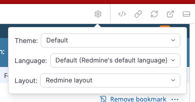
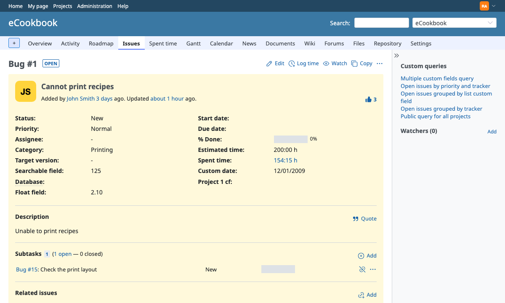
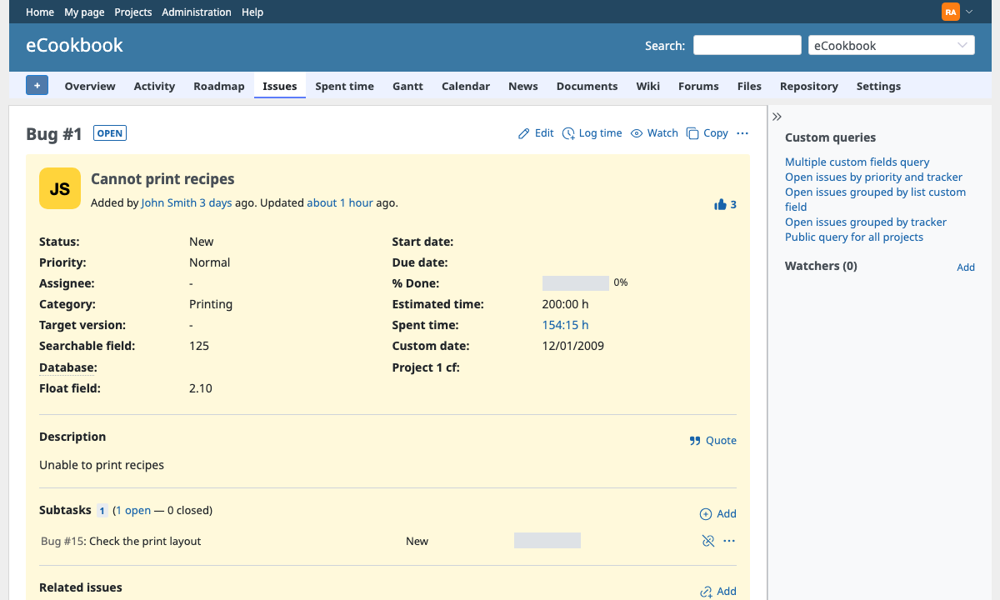
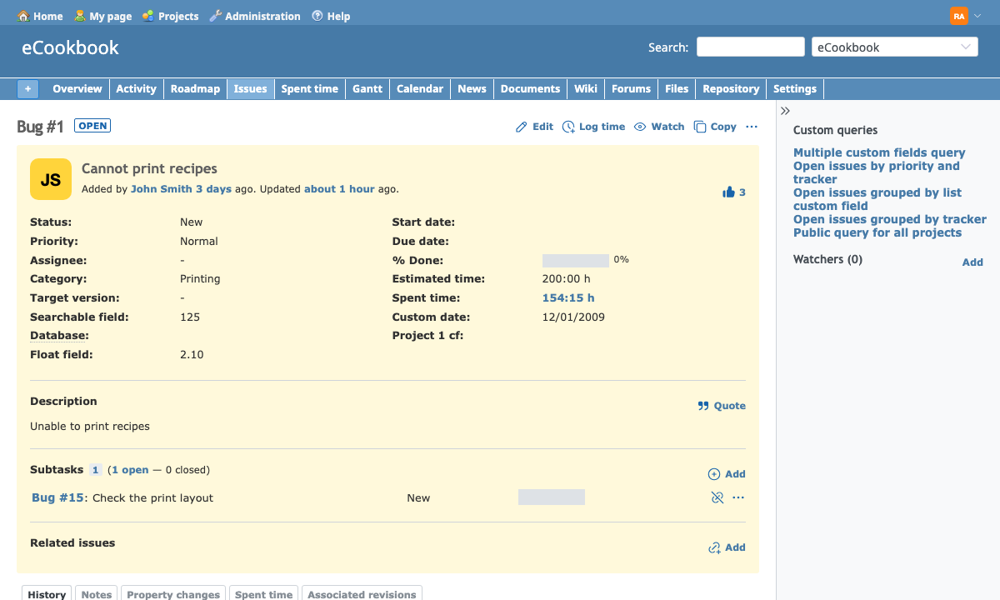
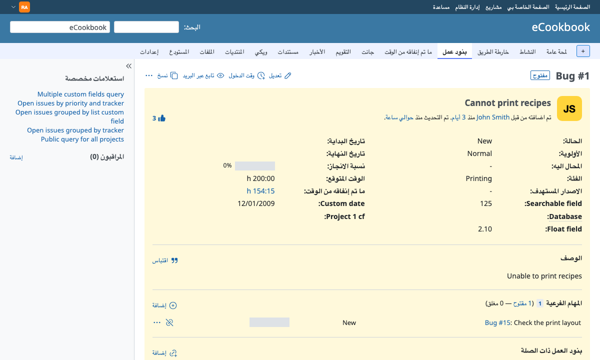
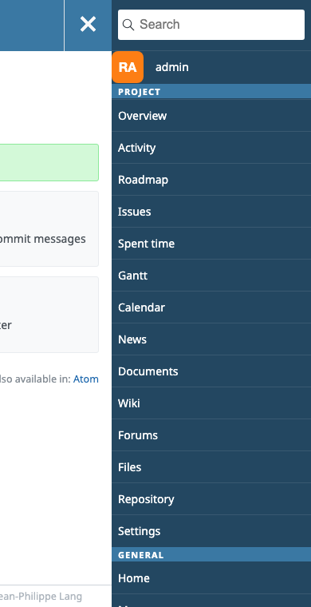
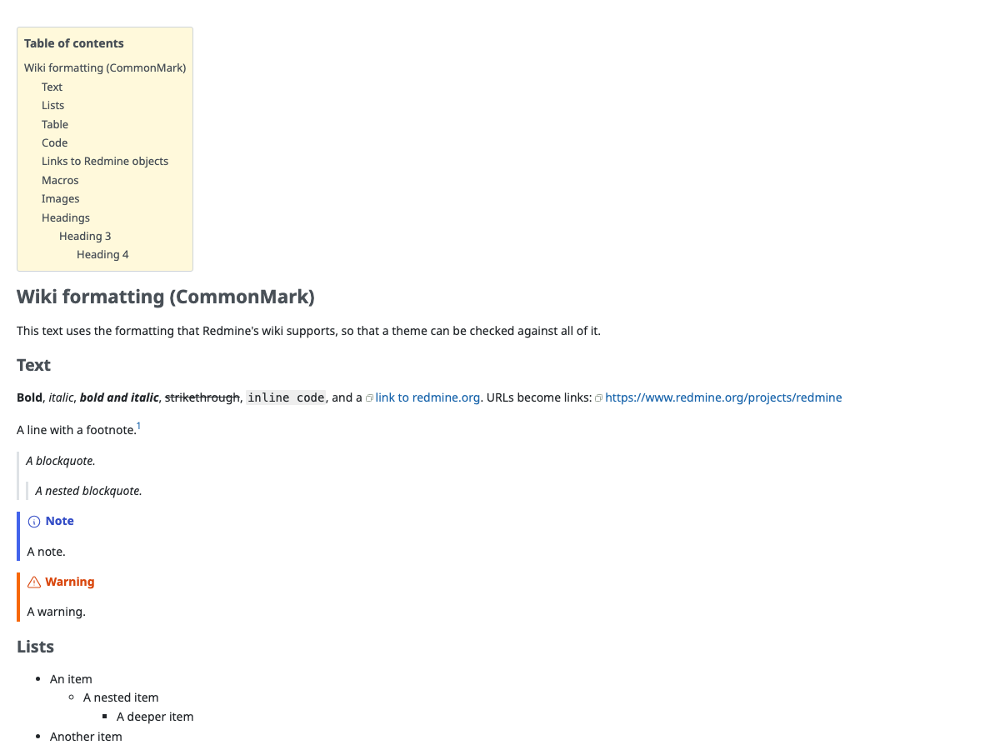

# Using the previews

Open `/lookbook` (for example <http://127.0.0.1:3000/lookbook>). The navigation lists the previews in two groups:

- **Components:** parts of Redmine's screens (buttons, forms, the issue list, menus and more), rendered with Redmine's helpers and partials. The "Layout" group has Redmine's layout parts and the whole layout with sample content, and the "Menus" group shows menus open, as after a click.
- **Pages:** whole Redmine pages, rendered by Redmine's controllers.

See the [preview list](previews.md) for all previews.

## Toolbar options

The display options in the toolbar (the gear button) apply to every preview.

| Option | Choices | Default |
| --- | --- | --- |
| Theme | Default, and every theme that Redmine finds | Default: Redmine's theme setting |
| Language | Default, and every language that Redmine supports | Default: Redmine's default language, from the administration settings |
| Layout | None (component only), Redmine layout | None |

- **Theme:** the chosen theme is used for the preview's request only. Redmine's settings in the database are not changed.
- **Layout:** "None" keeps Redmine's stylesheets, scripts and theme, and leaves out the header, menus, sidebar and footer. "Redmine layout" shows the whole page, as Redmine shows it. The "Layout" and "Menus" groups of components always render as in Redmine's layout, so this option does not change them.
- **Server:** when `REDMINE_LOOKBOOK_SERVERS` is set, a "Server" option shows the same preview rendered by another Redmine (see [Configuration](configuration.md#several-servers)).

## Checking a theme

1. Put the theme in Redmine's `themes/` directory (with Docker, in `docker/themes/` or the directory in `REDMINE_LOOKBOOK_THEMES`).
2. Restart Redmine. Redmine registers the files of themes when it starts, so a new theme needs a restart (see [Redmine 7 themes](https://redmine-kit.github.io/design-guide/themes.html#restart-and-reload) in the Redmine Design Guide).
3. Choose the theme in the toolbar.
4. Edit the theme and reload the preview.

Work through the [theme checklist](https://redmine-kit.github.io/design-guide/theme-checklist.html) of the Redmine Design Guide to cover what a theme has to handle.

The same issue page with Redmine's default styles and with the themes that come with Redmine, Alternate and Classic:

| Default | Alternate | Classic |
| --- | --- | --- |
|  |  |  |

## Right-to-left languages

Choose Arabic, Persian or Hebrew in the language option to check a theme in right-to-left layout. Redmine sets `dir="rtl"` on `<html>` for these languages.

## Narrow screens

Redmine's `responsive.css` changes the layout below 900 pixels wide. To check it:

- drag the resize handles of the preview pane in Lookbook, or
- open the preview on its own (the preview's URL starts with `/lookbook/preview/`) and use the responsive mode of your browser's developer tools.

Use the "Redmine layout" option to see the menus and the sidebar on narrow screens. The "Whole layout with the flyout menu open (narrow screens)" component shows the menu that the button in the header opens:

## Printing

Redmine's `application.css` has print styles (`@media print`). Open a page preview with the "Redmine layout" option on its own and use your browser's print preview.

## Wiki formatting

The "Wiki formatting" component has a `format` parameter: CommonMark (Redmine 7's default) or Textile. Change it in the preview's Params panel. Redmine's text formatting setting is not changed.

The sample texts cover text styles, quotes, lists, tables, code blocks with syntax highlighting, images, headings of every level and, in CommonMark, footnotes, task lists and alerts. They also cover links to Redmine objects (issues, notes, wiki pages, versions, projects, documents, news, forums, users and attachments) and the macros `toc`, `issue`, `collapse`, `child_pages` and `thumbnail`.

## Images and files

Images and other files in a preview (attachments, thumbnails, avatars) are loaded by your browser directly from Redmine. Files of private projects or private issues show only when you are signed in to Redmine in the same browser.
